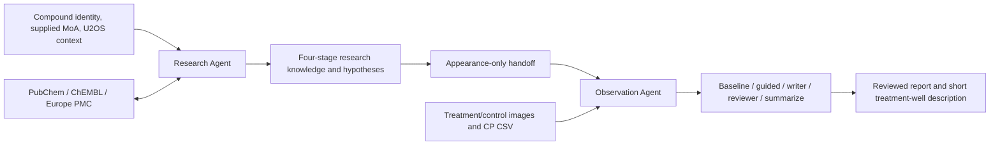

# RealCLIP D: portable research and observation agents

This folder is a standalone Python project containing the current two-agent D
implementation, exact active prompts, official data tools, output contracts,
synthetic examples, offline tests and a self-hosted model adapter. It can be
cloned to the H200 server independently of the repository's CLIP training code.

## What the two agents do



Research performs one complete SDK research run: compound identification,
compound research/analysis, morphology hypotheses and observation guidance.
Observation uses five internal modules with isolated contexts and actual images,
native-pixel crop inspection and CP queries. These are two functional agents;
the internal observation modules are not additional research agents.

The original four-stage research prompt remains the default. Read
[how the agents work](docs/HOW_AGENTS_WORK.md) for inputs, tools, intermediate
artifacts, information boundaries and the exact files to modify. Broader
mechanism-first research remains an **experimental prompt**, not a validated
replacement for the default.

## Install and run without a GPU or API key

Python 3.12 or 3.13 is required. Run from this folder:

```bash
python3.12 -m venv .venv
source .venv/bin/activate
python -m pip install -c constraints.txt -e . pytest pytest-asyncio
bash scripts/smoke_test.sh
pytest -q
```

Alternatively, `uv sync --locked` uses the included lockfile. Synthetic geometric
images and invented CP values are software fixtures, not biological evidence.
Saved real run directories, datasets, model weights and credentials are excluded.

## Use a model hosted on the H200

The GPU serves an open-weight model; this Python project runs the agents and
calls its API. Research needs tool calling and JSON schema output. Observation
also needs image input and repeated image/tool interactions. Use a VLM supporting
these features if both agents share one model. No checkpoint is selected or
downloaded automatically.

1. Follow [the H200 setup](docs/H200.md) to serve the chosen model with vLLM.
2. Copy `configs/local.example.json` and set the served model name and endpoint.
3. Run the server check, first without generation and then with the explicit
   two-turn vision/tool/schema probe:

```bash
python -m realclip_d.local_provider_check --config configs/local.example.json \
  --output runs/server-check
python -m realclip_d.local_provider_check --config configs/local.example.json \
  --output runs/server-check-generation --generate
```

4. Run real research with an explicit input:

```bash
realclip-d research --input /path/to/compound.json \
  --config configs/local.example.json --mode live --output runs/research-one
```

5. Run observation using a separate input containing actual image paths and CP:

```bash
realclip-d describe --input /path/to/well.json \
  --research runs/research-one/research/result.json \
  --config configs/local.example.json --mode live --output runs/observe-one
```

Some research hypotheses require a reviewed appearance-only handoff revision;
use `--handoff /path/to/revision.json` when the existing preflight reports one.
The handoff does not copy mechanisms into a visual description automatically.

The local config disables OpenAI-hosted web search. PubChem, ChEMBL and Europe
PMC function tools still work over the server's internet connection. It uses
`LOCAL_MODEL_API_KEY`, not `OPENAI_API_KEY`, and uses inline images, not OpenAI's
Files API. `/tokenize` must count the actual chat messages, tool definitions and
multimodal input; there is no byte-count or cloud fallback when it fails.

USD rates are zero in the local example. `budget_usd=1` satisfies the existing
run-ledger interface; it is not an estimate or limit of GPU rental cost. Model
turn, tool, context and output limits still apply. Actual provider token usage
is recorded. Unknown usage stops the affected run; generation is not retried.

## Original OpenAI profile

Use `configs/openai.example.json`, export `OPENAI_API_KEY`, and set an explicit
positive budget. This retains `gpt-6-luna` with high reasoning and the Responses
API. The local adapter does not change those prompts or the original provider.

## Validation scope

CPU/offline checks validate orchestration, tool calls, structured output,
image/crop transport, exact count/generation message conversion and artifact
handling. Actual H200/model inference must be checked on the target server.
Changing models can change research and visual quality; compare a few compounds
and wells before scaling. This folder does not train CLIP or claim GPU validation.
