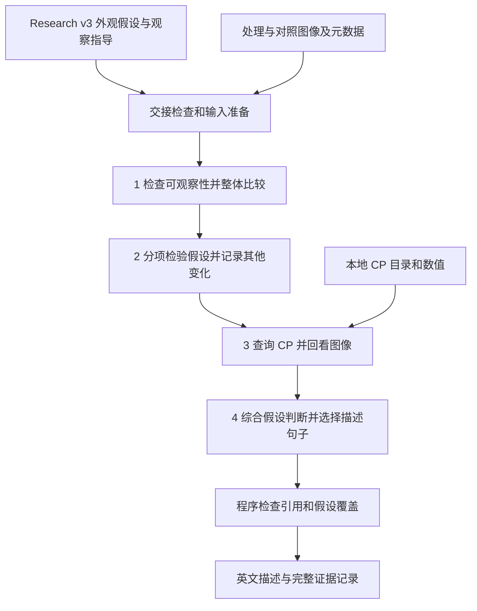

# Observation Agent 流程设计

状态：已接入新版 Observation Agent，并完成离线流程验证；尚未做付费图像观察。具体字段和命令见[实现说明](OBSERVATION_AGENT.md)。本方案面向 ResearchResultV3，沿用 D 的 Python、OpenAI Agents SDK 和独立上下文；一个 Observation Agent 完成观察、CP 查询和描述。

目标是把研究假设转成可以执行的图像比较，保存支持、反对和无法判断的证据，再生成可追溯的英文形态描述。对复合假设允许部分支持，也允许记录研究假设没有覆盖的外观。

## 设计依据

本方案对应 [research_pilot_3_v3_20261020 报告](../runs/research_pilot_3_v3_20261020/index.html) 中的三个 U2OS 案例，共 8 条假设。该轮输入的剂量和时长未知，没有图像或 CP；以下任务表是观察计划，不是实际看图结果。

配套草案：

- [英文行为 prompt](observation_agent_design/observation_prompt_draft.md)
- [独立输出格式说明](observation_agent_design/output_format_draft.md)
- [合成输出示例](observation_agent_design/output_example.synthetic.json)：只说明部分支持、共用证据和文本生成，所有图像 ID、外观与数值背景均为虚构。

## 输入和交接

Observation Agent 接收以下信息：

| 输入 | 内容与用途 |
|---|---|
| 观察任务 | 每条 hypothesis 的 ID、change、applicability，以及对应 where_to_look、what_to_check、how_to_compare |
| 当前实验条件 | 细胞系、剂量、处理时长；未知值保留 null |
| 图像和清单 | 匿名 ID、处理/对照角色、实际通道与染色说明、孔与视野、overview/crop 关系、尺寸和裁剪坐标；缺少的元数据明确标未知 |
| 显示说明 | 可获得时提供像素尺度、采集和显示强度处理、饱和信息及跨通道配准关系；无法确认强度可比时限制亮度结论 |
| CP 目录和查询 | 实际可用 compartment/channel/family、预处理说明、单位、测量范围，以及分页查询入口 |

药名、化学标识、MoA、研究 basis、文献和来源不进入观察请求。它们继续保存在原研究记录中。成像染色说明用于解释图像，不等于化合物机制信息。

### 新版结果的交接修订

当前 `hypothesis_view` 直接复制自由文本，仍需单独检查语义。三个结果中的具体问题是：

| 位置 | 当前问题 | 观察任务中的处理 |
|---|---|---|
| Staurosporine H3 applicability | 直接出现药名，当前字面检查会拒绝交接 | 保留“证据来自其他细胞系，U2OS 适用性不确定，剂量/时长未知”，移除药名及证据排名措辞 |
| Rapamycin H2 how_to_compare | 包含 mTORC1 inhibition，字面 MoA 检查未覆盖这一表达 | 保留面积、密度、分割和视野比较；把机制解释留在研究记录 |
| Nocodazole H1 applicability | 用 damaged/dying 预先解释某类细胞 | 保留异质性提示，要求分别检查不同外观的细胞，不预先赋予存活状态 |
| Nocodazole H3 guidance | 要求跨 replicate wells 检查 | 仅在材料确有多个孔时执行；只有单孔多个视野时按实际范围记录 |

交接适配层保存原字段、观察用字段、修改理由和版本。修订只能保留原有外观方向、实验条件、比较目标和不确定性，不增加科学结论。自由文本修改必须可审阅，不能靠删除几个词就宣称已完成语义隔离；仍有问题时在发送模型前停止。原研究结果不改写。

## 一次观察运行的流程

初版在同一个 agent 上下文中提供图像和假设，按四步完成任务。第一步是整体观察指令，不能称为独立盲观察。如果未来要测量假设引导造成的偏向，需要另设分阶段暴露的实验，先保存未见假设的观察，再提供研究交接；本方案不默认增加该实验或额外模型阶段。

### 第一步 检查可观察性并整体比较

确认处理/对照、实际通道、视野与 crop 的关系，识别失焦、饱和、细胞重叠、边界不清和显示不一致等限制。先从 overview 看群体和视野差异，再通过实际提供的细胞级图像检查局部结构。

记录主要可见外观和跨视野差异，关注研究没有预测的变化。overview 与同源 crop 不算独立证据重复；处理和对照的相同坐标不是同一细胞。不同通道只有在配准关系可靠时才能用于同一细胞的联合判断。缺少轮廓时，不从核的位置猜测精确细胞面积。

图像被发送给模型只证明其可访问。模型报告 inspected 也不是独立证明其完成了每个观察。保存实际发送的图像清单，并要求逐项引用与说明；不能把清单完整率叫作生物学准确率。

### 第二步 分项检验假设并记录其他变化

依据 change 和 guidance，把复合假设展开成少量可分别判断的检查项。每项说明观察到什么、与对照的区别、范围及证据。重复的外观使用同一条 observation，多个假设可以引用它。

先描述未经筛选的整体细胞/视野分布，再比较相近密度、图像质量等条件下的外观。若要按细胞大小或密度匹配，记录该比较用于解决什么问题，保留整体差异，避免把待检验的大小变化在匹配中排除掉。

视野丰度减少、细胞变圆、核变亮分别记录。要声称“小圆细胞伴亮核”，还需要在可配准的图像中观察同一细胞的共现，不能把独立的群体变化拼成联合表型。

研究条件不匹配与图像不可观察分别处理。文献来自其他细胞系或本次剂量未知，不妨碍判断当前可见外观；它们限制的是研究外推与机制解释。无法辨认目标结构时保留 uncertain，不强行否决。

### 第三步 查询 CP 并回看图像

程序先提供从当前表生成的目录，agent 再用现有 `query_cp` 按真实 compartment/channel/family 查询，检查 total/next_offset 并按需继续翻页。不能把未查询的行当成已读证据，也不能只展示有利于假设的特征或方向。初版无需新增联网工具。

查询必须包含相应处理/对照、实际值、单位、缺失情况和测量范围。记录真实的输入预处理，不能因为 D 没有额外归一化就把已标准化的上游数值解释为原始荧光、面积或物理倍数。实现通过 `tool_transform` 和 `input_preprocessing` 区分“本工具未执行变换”和“输入预处理已知或未知”。

CP 可以支持测量比较、提示回看图像，也可以与图像冲突；三种情况均保存。只有 CP 有变化而图像看不清时，保存 measurement-only observation，不进入视觉描述。全孔测量不确认某一 crop、视野或细胞中的局部变化。缺少 CP 不阻止视觉观察。

本方案允许记录视野级丰度/覆盖差异，因为新版 research 明确包含这一任务。它不自动继承其他方案的 no-count 规则；描述限于实际图像范围，不由丰度变化判断死亡、增殖或全孔总量。

### 第四步 综合假设判断并选择描述句子

每条输入假设必须且只能有一条综合判断。每个检查项采用 supported、not_supported、uncertain；整条假设额外允许 partially_supported。

| 判断 | 含义 |
|---|---|
| supported | 必要的可观察部分有相应图像证据，结论按实际范围限定 |
| partially_supported | 至少一个组成部分获得视觉支持，其他部分未获支持或无法判断；明确分别是什么 |
| not_supported | 相关部分可观察，提供的图像没有支持预期变化或呈相反方向；不宣称排除其他条件下的效应 |
| uncertain | 证据不足、分辨能力不足或冲突无法解决；说明缺失检查和视野差异 |

“少数细胞出现某外观”只支持该范围。不同视野出现相反模式时记录冲突，不通过多数投票制造一个整齐的总体结论。没有明显差异可以成为有范围限定的观察，不等于证明两组等同。所有检查项都 uncertain 时，整条假设不能标 partially_supported。

## 输出与描述生成

实现采用新的观察输出格式，不为旧观察结果增加兼容适配。模型返回五部分：

| 字段 | 设计 |
|---|---|
| sample_id | 与本次输入一致 |
| observations | id、text、scope、image_ids、cp_feature_ids、visually_confirmed；每条是一句能独立检查的英文外观或测量记录 |
| hypothesis_assessments | hypothesis_id、assessment、checks、reason；checks 含 check、assessment、observation_ids、reason |
| description_observation_ids | 选择进入描述的 observation ID，按叙述顺序排列，不重复 |
| limitations | 无法执行的检查、显示问题、未知条件及未解决冲突 |

没有 research 假设对应的新外观也可以生成 observation。一个 observation 可以被多个检查项引用，不因此计为多份独立证据。每条比较型视觉 observation 的 image_ids 包含相应处理与对照；辅助定位图像可以附加，但不能代替目标通道的主体证据。

首版由程序将 `description_observation_ids` 对应的 observation.text 用空格顺序连接，生成最终 `description`，不再调用模型润色。agent 负责选择观察与写出自然句子，程序保留逐句映射，避免摘要时新增结论。

只有 visually_confirmed=true 且引用有效的视觉句子可进入描述；允许空选择，导出 description 为空并保留理由。纯 CP、未验证假设、机制解释和无法分辨的外观留在记录中。描述不写药名、MoA、文献、死亡/凋亡/有丝分裂停滞/自噬等机制结论，也不把 CP 数值改写成视觉事实。局部或异质性描述在句子本身保留范围。

程序加入合同版本、最终 description、来源哈希、模型/配置和运行状态等运行信息，模型不生成这些元数据。证据引用有效不自动证明外观解释正确。

## 新版 8 条假设的执行计划

下表的 CP 列是查询方向；真实 channel/family 名称必须从实际表目录取得。没有列出的测量或标记时不能补造。

| 案例与假设 | 分开的观察项目 | CP 辅助方向与主要限制 |
|---|---|---|
| Nocodazole H1 | 圆度、紧凑程度、铺展与突起、受影响细胞范围 | 实际细胞形状/面积特征；只有 DNA 时无法充分判断整细胞边界 |
| Nocodazole H2 | 核面积/轮廓、亮度、大小形状异质性，与细胞外观的共现 | 核形状/强度/纹理；亮度受显示和饱和限制，不能据此确认有丝分裂停滞 |
| Nocodazole H3 | 可比视野细胞丰度、小圆细胞比例、小圆细胞与亮核共现 | 有实际计数或覆盖测量时使用；需整视野及可靠通道配准，不能从精选 crop 推全视野 |
| Staurosporine H1 | 面积/铺展、圆度、边缘不规则、起泡样细节 | 细胞面积/形状；起泡样边缘不能由面积变化替代，AGP 组分不能随意拆解 |
| Staurosporine H2 | 核面积、紧凑/亮度、轮廓、邻近小 DNA 阳性结构 | 核形状/强度/纹理；归属不清的小结构记录为外观，不直接命名为核碎裂 |
| Staurosporine H3 | 延长/连接状染色、短点状/紧凑分布、细胞内空间分布 | Mito 纹理/颗粒度/分布类测量；检查细胞大小、信号减弱、失焦；匹配细胞子集之外保留总体观察 |
| Rapamycin H1 | 较大点状结构的显著程度、可辨尺寸/丰度、粗细纹理 | 胞质相关纹理/颗粒度；按新版“减少”方向检查，同时记录相反方向；不命名溶酶体 |
| Rapamycin H2 | 投影细胞面积、胞质延伸、视野间面积模式 | 细胞面积/形状；密度与分割可干扰，不能按细胞大小匹配后再声称完成大小效应检验 |

优先复用 H1/H2 的观察判断 Nocodazole H3，但保留 H3 独有的丰度和同细胞共现检查。Staurosporine 的线粒体模式是本轮新增的重要观察目标；Rapamycin 的点状结构方向与旧版不同，观察请求只使用本轮绑定的假设。

## 接入顺序和验收

| 顺序 | 实现工作 | 完成标准 |
|---|---|---|
| 1 | 在新目录建立可审阅的交接视图和修订记录；补图像/CP 元数据 | 三个新版研究结果可生成不含私有研究解释的观察任务，原研究文件保持原样 |
| 2 | 新 prompt、独立输出说明和新版合同；只接入 Research V3 | 不再依赖 research v3 未提供的 verification、basis 分类或 cp_checks |
| 3 | 输入准备、CP 目录和比较范围，接入单个 agent | 实际材料可追溯；缺 CP 可运行；缺图像不得宣称视觉观察 |
| 4 | 假设覆盖、引用和描述句子选择校验 | 每条假设有一条判断；未知 ID、未暴露 CP、纯 CP 入描述、重复选择均被拒绝 |
| 5 | 先离线边界验证，再另行安排真实小样本观察 | 分别报告结构有效性、模型观察和科学复核，使用新输出目录 |

有意义的离线案例包括：复合假设部分支持；同一观察关联多条假设；只有 CP 变化；缺通道/显示不可比；跨视野冲突；所有假设不支持但发现新外观；无可信视觉句子；未知图像/CP/假设引用；三条交接语义问题。合成图像只验证程序边界，不验证生物学能力。

真实观察前需提供匹配的处理/对照图像及元数据，CP 可选。当前新版研究 pilot 自身不含这些材料。预算、请求上限、已发送请求和未知用量继续由 D 原有记录机制管理；本设计不启动 paid run，也不为不理想的输出安排自动重采样。

## 实现位置

- `prompts/observation_v4.md` 和 `observation_output_format_v1.md` 使用 Research V3 的真实交接字段。
- `observation_contracts.py` 定义分项检查、综合判断、描述选择和程序组装结果，允许有理由的空描述。
- `observation_protocol.py` 校验带哈希与原文的交接修订；`inputs.py` 提供孔/视野/crop/显示关系。字面检查不能代替语义复核。
- `agent_runtime.py` 使用单个独立 agent 与本地 CP 查询，绑定新输出结构，保存模型可见内容和原始回执。
- `workflow.py` 校验引用、假设覆盖和描述组装并保存完整记录；`observation_offline.py` 提供禁止联网的合成流程验证。

配套 draft 文件保留最初设计，实际运行使用 `observation_v4.md` 和独立输出格式说明。离线软件检查通过不等同于生物学观察能力已获验证。
