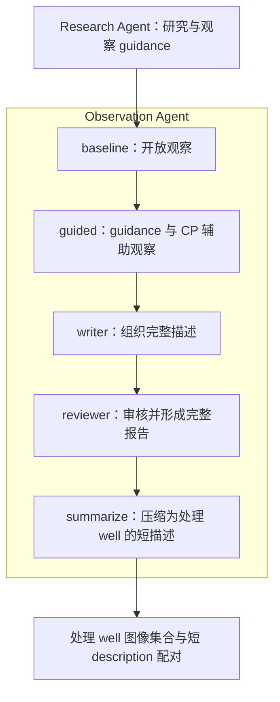

# Observation Agent：五个内部模块

系统只有两个功能 agent：Research Agent 和 Observation Agent。Research 提供检索结果
和形态观察 guidance；Observation 从 Cell Painting 图像出发，结合 control 与
CellProfiler（CP）生成完整报告，再由自己的最后一个 Summarize module 输出短描述。

最终配对关系是：**一个处理 well 的多 site、多 channel 图像集合 ↔ 一份短英文
description**。Control 辅助观察，不进入默认 CLIP 图像集合；短描述应能独立描述处理
well。Hypothesis 提供观察方向，不要求描述复述或证实它。



## 各模块的职责

| Module | 主要输入与能力 | 输出 |
|---|---|---|
| baseline | 所有提供的处理与 control 图像、成像背景；可局部查看；不看 hypothesis，不查询 CP | 图像优先的开放观察、已审阅图像范围、限制 |
| guided | baseline、研究 guidance、完整图像与 CP 查询能力；可局部查看 | 保留 baseline 的扩展观察、CP 解释边界和 hypothesis assessment |
| writer | 已整理的图像与 CP 证据及限制；不另行看图、查询 CP 或读取完整 Research | 完整描述草稿及其句子与观察的对应关系 |
| reviewer | 图像、观察证据、描述草稿；可局部查看；不另行查询 CP | 对草稿逐句保留、修改或删除，形成完整审核报告 |
| summarize | 按目标图清单筛选的审核句上下文、可用 observations 及其视野范围与限制；无图像或查询工具 | 一段短英文 description 纯文本 |

前四模块继续保存完整观察和证据。Summarize 是独立上下文中的一次文本压缩调用，
不继承整个研究或观察对话、不重新观察图像、不查询 CP。其模型返回值只有 description；
应用另外保存 sample、模式、字数、输入及调用记录。

SDK 内部可以用多个 `Agent` / `Runner` 实例承载这些模块；这不改变产品流程中的
两个 agent 划分。普通使用者只运行 Research，或运行完整 Observation，无需单独操作
Summarize。

## 完整报告与短描述

完整报告仍可包含处理与对照比较，以及与 CP 相关的支持、冲突和限制。它保留研究与
观察细节。Summarize 从已审核内容中挑选处理 well 自身能支持的外观，删除相对对照
才能成立的表达、对照独有内容、机制推断及无关重复。

例如，“比对照小”本身不能压缩成“小”；“部分细胞呈细长轮廓”需要保留“部分”这个
范围；不同 site 的异质性可以保留，但不将 site 当作独立 replicate well。
前四模块的 prompt 内容不因这次接入而改写。

Summarize 默认偏好 1–3 句、约 30–60 个英文词。**短描述不附证据、不要求引用 ID，
也不做生成后的引用检查或自动二次修正。** 长度和内容筛选由 prompt 指导；程序保留
非空、英文检查和调用前输入、来源及预算检查。完整报告原有的审核和证据记录继续保留。
细节见 [Summarize module](summarize_module.md) 及其
[prompt](../src/realclip_d/prompts/summarize_v1.md)。

## 处理 well 与通道配置

输入需要明确识别一个处理 well；每张图像标注 well、role、channel、site 等元数据。
Control 可有自己的 site 数，不假定同编号 site 是同一细胞，也不假定不同通道天然配准。
完整流程在付费调用前检查目标身份与可用的摘要通道范围。

`observation_summary_channels` 默认是 `["DNA", "RNA", "ER", "Mito", "AGP"]`。
自动清单取配置通道与实际原始处理图通道的交集，包含这些通道所有已提供 site。
Control 与 Brightfield 默认排除；需要其他 CLIP 通道时在配置中显式改列表。至少要有
一个可用的选中通道。清单保存当前具体来源视图，未来训练时的编码器 resize、crop 和
归一化仍需另行确定。

## 命令与目录

从 `D` 目录运行，普通命令保持不变：

```bash
# Research + 完整五模块 Observation；默认离线 mock。
uv run realclip-d run --input examples/sample.json --output runs/module-demo

# 复用已有 Research，只运行完整五模块 Observation。
uv run realclip-d describe --input examples/sample.json \
  --research runs/module-demo/research/result.json --output runs/describe-demo

# 只运行 Research。
uv run realclip-d research --input examples/sample.json --output runs/research-demo
```

使用新的输出目录。`run` 和 `describe` 都自动运行 Summarize；无须第三条生成命令。

```text
run/
  research/
    result.json
    complete.json
  observation/
    reviewed/
      input.json
      result.json                 # V4 完整审核结果及证据
      description_evidence.json
      phases/
        baseline/
        guided/
        writer/
        reviewer/
      complete.json
    summarize/
      input.json
      visual_manifest.json
      instructions.md
      result.json                 # 该 module 的短 description 与应用元数据
      description.txt
      requests/
      responses/
      complete.json
    result.json                   # V5 Observation 最终结果
    description.txt               # 最终短文本
    complete.json
  budget.json                     # 两个 agent 所有模块共享
  status.json
```

`observation/result.json` 中：

- `description` 是 Summarize 返回的短文本，与外层 `description.txt` 一致。
- `full_description` 保留完整审核描述，其逐句证据在 `reviewed/result.json` 中。
- 版本、sample、模块位置等元数据由应用保存，不要求模型输出。

新结果不覆盖既有四阶段报告，也不将最终短描述写回已封存的完整报告。
单独 `python -m realclip_d.summarize` 只用于调试最后一个 module；新流程中的来源是
`observation/reviewed/`，调试结果不替代或更新已封存的正常 Observation 输出。

## 调用额度、恢复与离线模式

Research 和 Observation 各自默认最多八次模型请求。Observation 的总额度包括最后
Summarize 的一次调用；前四模块预留这一调用，总额度至少为五次。模型调用数不等于
模块数：前面的图像与工具循环可能需要多次请求，Summarize 最多一次。

所有模块使用同一个全局预算 ledger；各模块的调用都计入该运行的额度。没有新增自动
付费重试。审核报告与 Summarize 分别封存，只有两者成功后才完成 Observation 外层：

- 完整成功的运行校验后直接复用，不重新调用模型。
- Summarize 失败时保留成功的完整报告，不因压缩失败重跑图像观察。
- 未完成且已经发送的付费尝试不自动重发；用量不明时账本阻止后续付费调用。
- Replay 校验并复制完整结果，模型调用与网络调用均为零。

`mock` 使用本地 SDK fixture，无需凭据或网络。它检查编排和产物格式；合成图像及
脚本响应不代表真实形态观察，也不验证短描述的生物学准确性或 CLIP 效果。本次接入
只进行离线检查，没有新增付费调用或批量生成。
