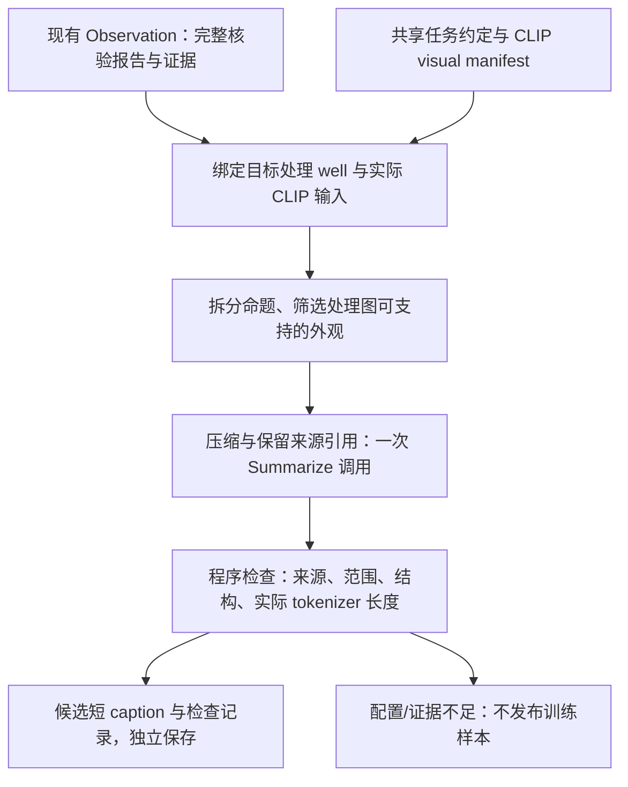

# Summarize 流程与接口设计

状态：设计稿，尚未实现、运行或接入 CLIP。前置现状见[任务背景审查](prompt_context_audit.md)。

## 共同目标与职责边界

数据来自 Cell Painting。最终一个正样本是：**一个处理 well 的指定多 site、多 channel 图像集合，与该处理孔可支持的一份短形态 caption 对齐。** control 和 CellProfiler 可以辅助上游观察、比较与限定；最终训练 caption 不依赖读者同时看到 control 才能理解的相对变化。

所有模块应知道这个目标和数据语义，但不需要看到相同证据：Research 仍研究化合物与机制；Baseline 仍不看假设/CP 数值；Writer 仍从证据写完整报告；Reviewer 仍核验完整报告。统一任务背景不改变这些访问边界，也不要求上游立即删去比较或 control-only 观察。

当前上游没有显式共享终端目标，本轮只记录缺口。拟议[共享背景](shared_task_context_draft.md)将来需显式接入；本设计不声称现有模块已经收到它。

## 后置数据流



第一版不设计额外研究、CP 查询或再次看图工具。拆分、筛选、组织与压缩是同一次模型调用内部的步骤。输出保存到独立 Summarize 产物，不写回 Observation。未来可在其后接语义/视觉核验模块。

## 输入：应用投影，不改上游 schema

| 字段 | 来源与用途 |
| --- | --- |
| shared_task_context | 共同的 Cell Painting 背景和终端 well 级配对约定；见独立草案 |
| target_treatment_well | 应用已验证的 anonymous sample ID、目标 treatment well 标识及来源绑定；不是从文件名推断 |
| description_sentences | Observation 最终保留的逐句文本、句子 ID、observation_ids；这是允许压缩的内容边界 |
| selected_observations | 仅上述句子实际引用的 observations，保留 text、comparison_kind、scope、image_ids、visually_confirmed 和已有 CP 限定 |
| limitations | 会约束候选事实的配准、身份、解释范围、CP 与可见性限制 |
| clip_visual_manifest | CLIP 实际输入的处理图清单和源证据映射，见下文 |
| constraints | 最多句数、软词数目标、最终 tokenizer/文本包装配置及硬 token budget |

不输入 Research 正文、hypothesis assessments、化合物身份或 MOA，也不重新开放未进入最终报告的 observations。选中 observation 中的其他未被最终句子保留的事实，不能因此重新进入 caption。

`description_evidence.json` 可作为引用索引，但其观察投影不包含全部原始字段；应用应从完整 result 的引用观察补齐所需字段，不假定裁剪后的记录含有 `visually_confirmed` 等信息。

上述字段是新的输入设计，不是当前 Research/Observation payload 已有的功能。

## CLIP visual manifest

manifest 至少明确：

- 目标处理 well；实际输入图像均属于该 well，不能夹带 control 或其他处理 well。
- 实际采用的 sites、channels、原图/裁图/其他 views；实际图像 ID 和 hash。
- 每个 CLIP 视图与 Observation 源图/裁图的 lineage 映射，必要时含 crop box 与父图关系。
- 缩放、裁剪、亮度映射等实际渲染配置；通道配准状态不因图像拼接自动变为 verified。
- 支持证据引用到 CLIP 实际视图的可核对映射，以及已知的细节可见性限制。

不将 Observation 看过的全部图像自动视为 CLIP 输入，不把同 well 的未输入 ROI 自动视为可用证据。目标身份、输入图像清单或来源映射缺失时，预检查停止，不调用模型猜测。若清单已明确但仍为 provisional，允许针对这份明确清单讨论或生成候选，必须标记配置未定、禁止训练导出；未知渲染可见性的细节仍应省略。只有最终图像与渲染配置确定并通过后续检查，才考虑训练资格。不得默认填成“全部原图”并标记可训练。

最新 Nocodazole 的 obs_3/4/11 主要引用 Brightfield_L。若实际 CLIP 只有五个荧光通道，这些明场独有细节不能仅因属于同一 well 就进入 caption；若最终句子有其他已引用、实际输入的证据，则按该证据重新核对可提取命题。

manifest 可以证明输入身份和覆盖，不自动证明缩放后的像素足以支持细小表型。对依赖缺失 ROI 或未知细节可见性的候选，省略该细节并记录原因；需要时留给未来视觉核验，不能让纯文本 Summarize 冒充像素验证。

## 五步处理

### 1. 应用预检查与来源绑定

确认 Observation 已完成且产物完整；确定一个目标 treatment well；确认最终句子与引用观察一致；绑定源 result 与实际 CLIP manifest 的 hash。

当前 `well_id` 可为空，不能假设已保证一个 treatment well。无法从已验证的实验元数据确定目标身份时，记录配置/身份缺口，不猜测、不调用模型弥补。模型不能修改 target_treatment_well 或 manifest。

### 2. 在最终句子内拆分命题

区分处理孔明确外观、双方共有外观、纯相对变化、control-only 信息及解释限制。证据记录用于理解与约束这些命题，不授权补充最终句子中没有的内容。

按命题处理而非按 comparison_kind 一刀切：

| 最终句子内容 | 允许的处理 |
| --- | --- |
| treatment 有孤立、长形轮廓 | 保留明确的处理孔外观与范围 |
| 双方代表性视野均以椭圆 DNA 轮廓为主 | 可提取处理孔代表性视野中的椭圆轮廓，不能推广为每个细胞 |
| control 密集，treatment 有孤立轮廓 | 可提取 treatment 有孤立轮廓这一明确事实 |
| treatment 比 control 的轮廓少 | 不能仅凭相对差异改成 sparse；无其他已保留的绝对描述则省略 |
| 没有一致增加的空泡样区域 | 不能改成没有空泡，通常省略比较性否定 |
| 某些细胞/某些 sites 有突起 | 保留 some/subset 等必要范围；具体 site 编号可移至引用 |
| 仅 control 的发现、仅测量记录 | 不作为处理图视觉事实 |

### 3. 检查事实与实际图像范围

保留 visually_confirmed 的已有视觉事实，引用与其对应的实际 treatment 图像。双方共有记录可以使用其 treatment 支持；不能因整条 observation 有一个 treatment 引用，就认为其中所有子命题都由处理图支持。

引用必须与源句及观察的角色、通道和范围一致。图像 ID 出现在清单中只证明引用存在；应用检查不自动证明语义支持。

CP 只通过已有视觉观察中的评估与 effect_on_description 限定改写。不重新查询、计算、解释 raw values，不从 CP-only 记录填充新视觉事实。not_informative/缺测量不意味着图像外观不存在或正常。

跨通道外观可并列，但没有原证据时不能写成同一细胞内共定位。单个 ROI、局部或亚群不能被提升为整个 well 的统一特征。

### 4. 选择和压缩

优先挑选少量明确、有信息量的外观。完整报告可很详细，短 caption 不要求逐通道覆盖或逐条回应假设，也不为每个化合物强造独特性。

初始文字目标为 1–3 句、约 30–60 个英文词。词数是软目标，无硬性最小值；可靠事实较少时可以更短。保留 some、occasional、varies across fields 等必要表型语义；移除比较过程、内部工具词、重复描述和与训练外观无关的解释。

模型仅提出候选句子，不能报告自己精确计算了 tokenizer token 数。

### 5. 组装、检查和独立保存

应用将输出句子按顺序用单个空格连接为 caption，避免让模型另写一份不同步的 caption 字符串。原句 ID、观察 ID、实际 treatment 图像映射与省略原因保留为旁路审计，不进入 CLIP 文本。

所有普通调用、长度纠正和失败尝试在未来实现时都必须受显式预算约束。可以预留至多一次针对结构或超长的纠正，不自动扩张预算；证据不足、身份不明和未知视觉可见性不通过重复生成解决，也不触发重跑 Observation。

## 模型输出草案

`status` 只表示模型是否给出候选，不代表已获得训练资格。最终是否可用于训练由应用及后续必要核验决定。

以下为接口讨论示例，非新模型结果；假设目标 manifest 包含引用的四张处理 DNA 图：

```json
{
  "status": "candidate",
  "sentences": [
    {
      "id": "sum_s1",
      "text": "Field occupancy varies across sites, including sparse fields.",
      "source_sentence_ids": ["s3"],
      "observation_ids": ["obs_2"],
      "treatment_image_ids": [
        "D_R001_treatment_s1_DNA",
        "D_R001_treatment_s2_DNA",
        "D_R001_treatment_s5_DNA",
        "D_R001_treatment_s6_DNA"
      ]
    }
  ],
  "omissions": [
    {
      "source_sentence_ids": ["s1"],
      "claim": "Treatment coverage is lower than control coverage.",
      "reason": "relative_only"
    }
  ],
  "abstain_reason": null
}
```

完整来源还包含处理 sites 的其他图像；例子保留较稀疏与相对更有覆盖的处理视野引用，用于支持“范围有差异且包含稀疏视野”，不声称建立所有 sites 的严格计数或疏密排序。

`status=insufficient_evidence` 时 sentences 必须为空，abstain_reason 给出证据缺口。不能用 normal、unchanged 或 no obvious abnormalities 替代弃权。

省略记录按命题而非整句，包含 source_sentence_ids、claim 和 reason。原因代码统一为 control_only、relative_only、outside_visual_input、correspondence_unverified、visibility_unverified、cp_only、scope_or_meaning_uncertain、redundant_or_low_priority、interpretation_unverified；保留必要的可见外观时，不因身份未知而自动删除整条外观。

## 确定性检查与检查边界

拟议程序检查包括：

1. 来源与 manifest 绑定正确，目标是一个已识别的处理 well。
2. 每个 source_sentence_id 属于最终保留的句子；每个 observation_id 属于对应源句的引用集合。
3. treatment_image_ids 存在、角色正确、属于目标 well，并与引用 observation 及实际 CLIP 输入映射一致。
4. status、空/非空句子、abstain_reason、唯一句子 ID 等字段一致；最多句数满足配置。
5. 用选定 tokenizer 测量真实送入文本端的完整文字，计入实际 prefix/wrapper 和特殊 token。token budget 不针对审计 JSON，也不能无条件套用 77。
6. 不机械截断。无 tokenizer 配置或超过长度仍未解决时，不发布为已验证训练样本。
7. 记录源 artifact hash、manifest/render hash、prompt/共享背景草案版本、最终 caption 与检查记录；不改写上游文件。

这些检查不能证明改写的语义蕴含、视觉真实性、所有细节在缩放后仍可辨，或训练会有收益。原 Reviewer 认可的原句不等于认可新的短句；后续可独立接语义核验和实际渲染图像核验。第一版保留明确的 unresolved 检查状态，不把“引用存在”写成“事实已被证明”。

## 设计验收用例（本轮不实现测试）

- 双方共有的明确外观可提取到处理 caption；control-only 外观不能进入。
- fewer than control 不能在没有绝对证据时变成 sparse；no increase 不能变成 absent。
- some cells 不能丢失 some；跨 site 不一致不能压成 throughout。
- 仅明场证据在 fluorescence-only manifest 下被排除；未输入的 ROI 不由同 well 父图自动替代。
- 纯 CP 记录不能产生视觉事实；已有不可解释面积值不能被压成“小细胞”。
- 未被 Reviewer 保留的事实、以及选中 observation 中未被最终句子保留的其他内容不能复活。
- 短于词数目标但有充分证据可以保留；全无可用事实应弃权。
- tokenizer 未配置、目标 well 不明、输入范围未定时不假称可训练。

以上是流程与接口设计，不新增模型类、schema 类、CLI、工具、运行路径或训练任务。
